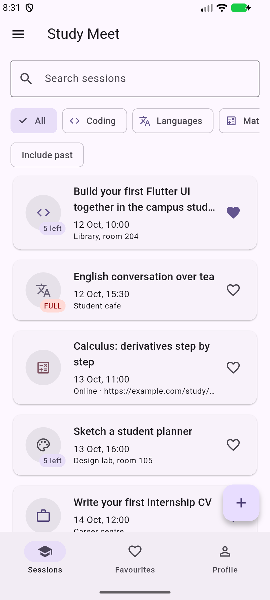
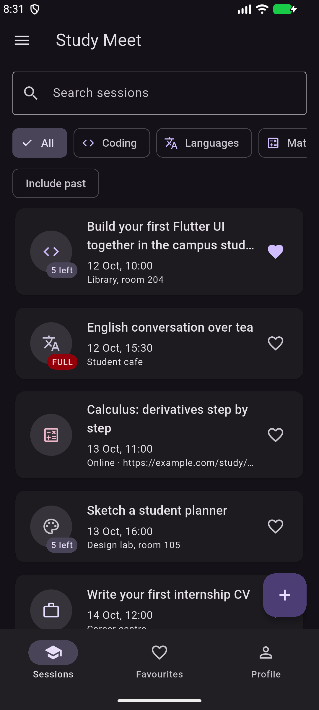
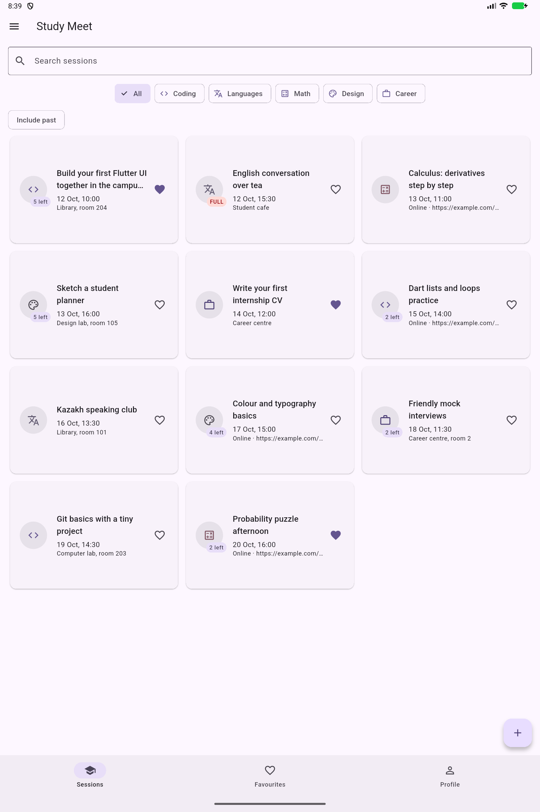

# Study Meet

Лабораторная работа 1 по Flutter. Приложение для студенческих встреч, на которых можно вместе разбирать программирование, языки, математику, дизайн и подготовку к стажировкам.

У встречи есть дата, категория, место или онлайн-ссылка, ограничение участников и список записавшихся. Можно искать встречи, добавлять их в избранное, записываться, создавать, редактировать и удалять. Данные хранятся только в памяти и сбрасываются при перезапуске приложения.

## Запуск

```bash
flutter pub get
flutter run
```

В профиле нужно заполнить имя и группу, например `CS-2401`, и нажать Done или Enter на клавиатуре. После этого можно записываться на встречи.

## Screenshots

Телефон, светлая тема:



Телефон, тёмная тема:



Планшетная ширина, сетка:



## Decisions

Список встреч и профиль находятся в State экрана ShellScreen, чтобы все три вкладки использовали одни данные.
Детали получают callbacks, потому что запись на встречу и удаление должны сразу менять общий список.
Форма возвращает StudySession через Navigator.pop, поэтому отмена формы не изменяет исходную встречу.
Для выбора между списком и сеткой используется LayoutBuilder, потому что он даёт доступную ширину области приложения.
PopScope сравнивает текущие значения формы с начальными, поэтому при возврате исходных значений предупреждение исчезает.
Модели имеют final-поля, а список участников копируется через List.unmodifiable, чтобы менять данные только через copyWith.
ThemeMode хранится выше MaterialApp, чтобы переключение темы действовало на все экраны.
С инструментами девятой недели можно было бы вынести работу с данными из экрана и добавить сохранение между запусками.

## Проверка

```bash
dart format .
flutter analyze
flutter build apk --debug
```

Используются только Flutter SDK и flutter_lints. Автоматические тесты не добавлены согласно условию лабораторной.
